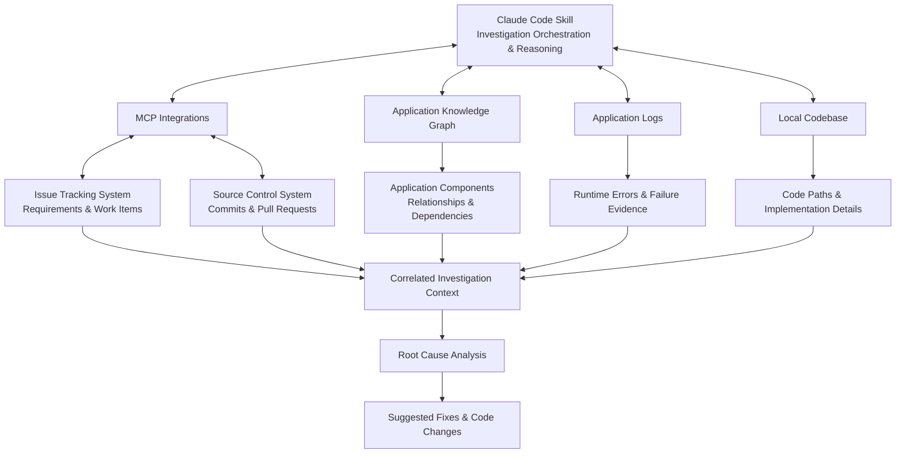

# AI-Powered Application Logs Analyzer

## NOTE: This is an independently created technical blueprint based on concepts and learnings from a professional project developed during my employment. It is intended for technical reference and demonstration purposes and does not contain any proprietary source code or confidential information.

## 1. Background

Application debugging in large enterprise systems often requires investigating information spread across issue trackers, source-control systems, application logs, and interconnected codebases.

This project introduces an AI-powered Application Logs Analyzer built as a custom Claude Code Skill, using MCP integrations to bring these sources together and assist developers with application issue investigation.

## 2. Problem Statement

When an application issue is reported, developers must manually correlate runtime errors with reported requirements, recent code changes, and application dependencies to identify the underlying cause.

This investigation can be time-consuming, particularly in large codebases where the relevant implementation and dependencies are not immediately obvious.

## 3. Existing Limitations

- **Fragmented Information:** Requirements, code changes, logs, and architecture information reside in different systems.
- **Manual Correlation:** Developers must independently connect runtime errors with relevant commits and application behavior.
- **Complex Dependencies:** Tracing errors across interconnected components requires significant codebase knowledge.
- **Time-Consuming Debugging:** Repeated context gathering and code exploration increase investigation effort.

## 4. Proposed System

An AI-powered debugging assistant that investigates application issues by correlating logs with issue requirements, commit history, and application architecture.

Using MCP integrations and a custom Claude Code Skill, it gathers relevant context, explores code paths, investigates potential failure conditions, identifies likely root causes, and suggests fixes or generates code changes for developer review.

## 5. Key Capabilities

- **Issue Context Retrieval:** Understand reported problems and expected application behavior.
- **Code Change Analysis:** Investigate relevant commits and pull requests.
- **Architecture-Aware Investigation:** Explore application components and dependencies through an application Knowledge Graph.
- **Log Correlation:** Connect runtime errors with reported issues and relevant code changes.
- **Code Path Exploration:** Investigate local source code to trace execution paths and failure conditions.
- **Root Cause Analysis:** Identify potential causes using evidence gathered across multiple sources.
- **Fix Generation:** Suggest remediation approaches and generate code changes for developer review.

## 6. Architecture

The solution combines the following components:

## 7. Evaluation

The POC was evaluated through practical application issue investigations, focusing on investigation effectiveness, diagnostic relevance, and the usefulness of its findings.

| Evaluation Metric                | How It Applies to the POC                                                                                  | Observed Results                                                                                                            |
| -------------------------------- | ---------------------------------------------------------------------------------------------------------- | --------------------------------------------------------------------------------------------------------------------------- |
| **Root Cause Analysis Time**     | Measures the time required to identify a likely root cause during an investigation.                        | Automated multiple investigation steps, reducing the need to manually gather and correlate context across systems.          |
| **Top-3 Root Cause Accuracy**    | Checks whether the actual root cause appears among the three most relevant causes identified by the skill. | Produced focused root cause hypotheses by combining runtime errors with relevant code changes and application dependencies. |
| **Precision@3**                  | Measures how many of the top three suggested causes are relevant to the reported issue.                    | Used issue requirements, log evidence, and code context to make suggestions more relevant than isolated log analysis.       |
| **Investigation Time Reduction** | Compares the effort required using the skill against a manual investigation of the same issue.             | Reduced repetitive context gathering by retrieving and correlating information from connected engineering systems.          |
| **Fix Acceptance Rate**          | Measures how often suggested fixes are accepted by developers after reviewing the generated changes.       | Generated actionable remediation suggestions and code changes that developers could inspect and validate.                   |

## 8. Results and Impact

- **Reduced Manual Investigation:** Automated the gathering and correlation of information that developers would otherwise need to investigate across multiple systems.
- **Faster Problem Isolation:** Helped narrow investigations to relevant code changes, application components, and execution paths.
- **Improved Diagnostic Context:** Connected runtime behavior with expected requirements and implementation changes.
- **Actionable Debugging Assistance:** Went beyond log analysis by providing potential root causes and suggested code-level fixes.
- **Improved Developer Productivity:** Reduced repetitive context gathering and helped developers focus on validating and resolving the underlying issue.

## 9. Future Enhancements

- **Observability Integrations:** Integrate platforms with realitme logs monitoring tool to retrieve runtime telemetry.
- **Real-Time Incident Investigation:** Extend the workflow to investigate incidents using live monitoring data.
- **Anomaly Correlation:** Connect runtime anomalies with recent deployments and code changes.
- **Automated Incident Context:** Automatically assemble relevant logs, affected components, dependencies, and recent changes.
- **Enhanced Root Cause Analysis:** Incorporate metrics, traces, and distributed application telemetry for deeper diagnosis.

## 10. Conclusion

The AI-Powered Log Analyzer demonstrates how AI agents, MCP integrations, and application Knowledge Graphs can improve enterprise debugging workflows.

By connecting requirements, source-control history, application architecture, runtime logs, and local code exploration, the POC transforms fragmented debugging information into a more structured investigation process—helping developers identify potential root causes and move toward actionable fixes.
